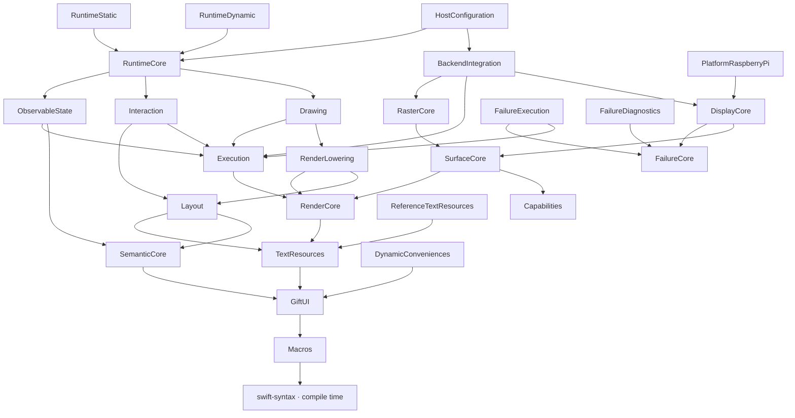
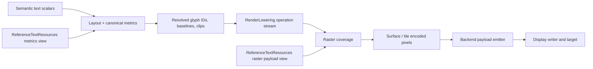
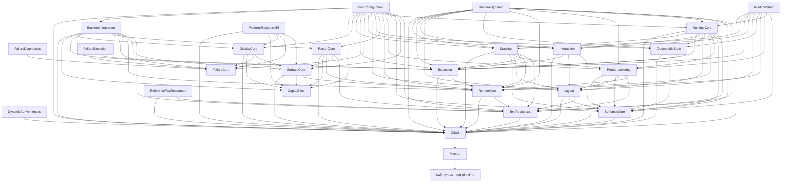

# GiftUI module dependencies and interfaces

Source snapshot: 2026-11-07, current working tree.

This is a descriptive implementation reference, not an ADR, Specification,
approval, or conformance report. It includes working-tree changes that may
still be under development. Accepted ADRs and approved Specifications retain
authority; this document does not make an implementation detail contractual.

## Scope and notation

The root [Package.swift](../../Package.swift) defines one Swift package named
`GiftUI`. The nodes below are its **26 GiftUI targets/modules**, not 26 separate
packages. The external `swift-syntax` package supplies the macro compiler
dependencies. SignalAnalyzer targets, tests, and failure-adapter fixture targets
are outside this document's module scope.

Three kinds of direction are distinguished:

| Notation | Meaning |
| --- | --- |
| Dependency graph `A → B` | A declares a build dependency on B. |
| Call direction `caller → receiver.method` | Code invokes a function, protocol requirement, or callback. The concrete receiver can live in a different module from the protocol. |
| Data direction `producer → consumer` | Values, borrowed views, operations, or results move between participants. Results commonly travel opposite to calls. |

`public` declarations can be exposed outside the package. `package` declarations
can cross module boundaries within this package, but are not public client API.
Most pipeline protocols below are `package` declarations. A library product in
the manifest does not make its package-scoped declarations public.

Method lists below identify the principal cross-module seams; they are not an
exhaustive API inventory. Linked source files contain complete signatures,
generic constraints, properties, overloads, and conditional declarations.

Navigation: [module graph](#module-graph), [boundary map](#boundary-map),
[interface details](#interfaces-in-detail),
[end-to-end flows](#end-to-end-call-and-data-flows),
[ownership/results](#ownership-and-result-interpretation),
[all direct dependencies](#complete-declared-dependency-graph).

## Module graph

Labels omit the common `GiftUI` prefix, except for `GiftUI` itself. This overview
uses the transitive reduction of the manifest graph: every arrow is a declared
direct dependency, and redundant direct arrows are omitted while all dependency
paths remain reachable. The complete direct graph is in the appendix.



The manifest graph is not the host's component construction graph. For example,
`GiftUIHostConfiguration` uses abstract factories and validation contracts; the
manifest does not give it a dependency on either concrete runtime profile or
the Raspberry Pi implementation. A host composition supplies those concrete
owners. See [ADR-038](../adrs/adr-038-construction-graph-and-operational-contracts.md)
for the distinction between construction and operational contracts.

## Boundary map

The contract owner column identifies where the shared vocabulary is declared.
An implementation can satisfy that vocabulary without its caller importing
the implementation module.

| Boundary | Contract owner and main objects/data | Calls and data direction |
| --- | --- | --- |
| Authoring → semantic expansion | GiftUI: `View`, `_GiftUISemanticTraversalVisitor`, primitive/modifier payloads | Semantic traversal calls declaration witnesses; declaration payloads flow into SemanticCore. |
| Model binding ↔ semantic expansion | SemanticCore: `SemanticStatefulBinding`; ObservableState: `ObservableSemanticBodyBinding` | Semantic expansion requests checked body evaluation; the binding supplies a scoped read and returns a body or typed failure. |
| Semantics → layout | SemanticCore: `SemanticLayoutView` | Layout queries primitives, children, modifiers, and text scalars; semantic data flows back to Layout. |
| Text → layout/render/raster | TextResources: `CanonicalTextMetricsView`, `TextRasterResourceView` | Layout/render query canonical glyph identity and metrics; raster queries payload records and borrows glyph bytes. |
| Layout → drawing/render/interaction | Layout: `LayoutResultSink`, `ResolvedRenderLayoutView` | Layout stages geometry into supplied storage; downstream consumers query bounds, clips, lines, and positioned glyphs. |
| Canvas → drawing plan | Drawing: `CanvasInvocationSource`, `DrawingPlanConstructionWorkspace` | Drawing invokes a source after layout; Canvas writes through GiftUI's `GraphicsContext`; a bounded plan is sealed. |
| Semantic/layout/drawing → render stream | RenderLowering: `RenderProducer`; Drawing: `CanvasRenderProducer` | Producers query borrowed views and push normalized operations into a supplied sink. |
| Render stream → raster | RenderCore: `RenderOperationSink`, `DrawingOperationSink`; RasterCore: `RasterFrameSink` | Producer calls sink methods; fills, positioned glyphs, and strokes flow to the raster session. |
| Raster → surface | SurfaceCore: `RasterSurface`, `CanonicalEncodedPixel` | Coverage algorithms issue pixel replacements; surface backing receives encoded pixel data. |
| Frame offer ↔ backend | Execution: `SynchronousFrameEndpoint` | Runtime calls `offer`; endpoint invokes the production callback with a sink; offer disposition returns to Runtime. |
| Backend → display | DisplayCore: `DisplayTarget`, `DisplayPayloadWriter` | Backend reserves a frame, writes pixel regions, submits payloads, and finishes or cancels. |
| Display → Raspberry Pi | DisplayCore protocols; PlatformRaspberryPi concrete target | `PiScreenDisplayTarget` implements display contracts and forwards RGB565 bytes to its framebuffer sink. |
| Input → actions → model | Execution input/capture values; Interaction resolvers; RuntimeCore bridges | Normalized input resolves against committed hit regions; a checked action dispatch mutates the current model target. |
| Profile ↔ runtime lifecycle | RuntimeCore lifecycle/storage protocols; RuntimeDynamic/RuntimeStatic implementations | Profile adapters call shared lifecycle/pipeline code and supply concrete storage and owner operations. |
| Startup → assembled host | HostConfiguration validators/factories | Validation consumes inert descriptions; a validated factory constructs an instance; activation enables runtime/input. |
| Owner errors → policy/diagnostics | FailureCore facts/policy/sink; FailureExecution adapters; FailureDiagnostics projector | Adapters correlate outcomes; policy chooses disposition; optional records flow to a diagnostic sink. |

## Interfaces in detail

### 1. GiftUI, GiftUIMacros, and GiftUIDynamicConveniences

**Objects and data.** `GiftUI` owns the public authoring vocabulary: `View`,
`ViewBuilder`, `Text`, `Button`, stacks, modifiers, `State`, `Canvas`, `Path`,
`GraphicsContext`, `GiftUIAction`, and `GiftUIActionHandler`. Shared geometry is
`GeometryScalar` (`Int32`), `Point`, `Size`, `Rect`, and `ProposedSize`; styles
include `Color`, `Shading`, and `StrokeStyle`.

**Methods.** `View._giftUITraverse(_:)` sends declarations to
`_GiftUISemanticTraversalVisitor`; `View._giftUIEvaluate(read:)` produces the
body using `_GiftUIFrameRead<Domain>` and can throw `_GiftUIAccessFailure`.
Visitor requirements include `visitCustomView`, `visitStatefulCustomView`,
`visitPrimitive`, `visitModifier`, and `visitActionPrimitive`.
`Canvas._giftUIDraw(in:context:read:)` writes drawing commands and can throw
`DrawingError`. `GiftUIActionHandler.handle(_:model:)` is a public action seam.

**Compile-time direction.** `@ObservableStateHost` in GiftUI names
`GiftUIMacros.ObservableStateHostMacro`. The compiler invokes its
`expansion(...)` overloads through SwiftSyntax macro protocols. The macro emits
observable-state declaration visitation, stateful traversal, and conformance
to `_GiftUIObservableStateHost`. Syntax and diagnostics flow between the macro
and compiler; this edge is not a frame-time call or a runtime SwiftSyntax service.

`GiftUIDynamicConveniences.DynamicCanvas` is an exact public type alias to
`Canvas`. It adds no separate drawing protocol or data flow.

Sources: [declarative interface](../../Sources/GiftUI/DeclarativeView.swift),
[state interface](../../Sources/GiftUI/ObservableState.swift),
[Canvas](../../Sources/GiftUI/Canvas.swift),
[drawing surface](../../Sources/GiftUI/DrawingSurface.swift),
[macro implementation](../../Sources/GiftUIMacros/ObservableStateHostMacro.swift),
[DynamicCanvas](../../Sources/GiftUIDynamicConveniences/DynamicCanvas.swift).

### 2. GiftUISemanticCore → GiftUI; consumers → semantic views

**Objects and data.** SemanticCore owns `SemanticExpansionSink`,
`SemanticExpansionWorkspace`, `SemanticStatefulBinding`, `SemanticRecordStore`,
`SemanticRuntimeRecord`, `SemanticRecordReference`, and `SemanticCompleteIdentity`.
Record references carry owner/bank/revision/ordinal information; complete
structural identity is distinct from a record's current storage reference.

**Calls.** `expandSemanticTreeWithStateBinding(...)` traverses authoring values.
Sink operations include `beginExpansion`, `stageStructuralOccurrence`,
`stageBodyEvaluation`, `stageSemanticOccurrence`, `stageModifierApplication`,
`stageActionOccurrence`, `publishExpansion`, and `discardExpansion`.
`withSemanticRecordStore(...)` lends storage-backed access;
`SemanticRecordStore.beginCandidate()`, `discardCandidate(...)`, and
`resetAfterQuiescence()` manage candidate/storage lifetime.

**Outgoing data.** `SemanticLayoutView` exposes `primitive(at:)`,
`childCount(of:)`, `child(of:at:)`, `modifier(of:at:)`,
`textScalarCount(of:)`, and `textScalar(of:at:)`.
`SemanticRenderView` exposes `scope(at:)`, `layoutIdentity(for:)`, children,
ordinal lookup, and `renderSnapshotVersion`. Record adapters project stored
semantics into these views. Layout and RenderLowering pull those values; they
do not require SemanticCore to import them.

Sources: [expansion contracts](../../Sources/GiftUISemanticCore/GiftUISemanticCore.swift),
[record store](../../Sources/GiftUISemanticCore/SemanticRecordStore.swift),
[record expansion](../../Sources/GiftUISemanticCore/SemanticRecordExpansion.swift),
[record identities](../../Sources/GiftUISemanticCore/SemanticRuntimeRecords.swift),
[layout view](../../Sources/GiftUISemanticCore/SemanticLayoutView.swift),
[render view](../../Sources/GiftUISemanticCore/SemanticRenderView.swift).

### 3. GiftUIObservableState ↔ model ownership, semantics, and execution

**Objects and data.** `ObservableStateModel` supplies a schema, materialization,
attachment, detachment, and change reporting. `ObservableModelScope`,
`ObservableModelTicket`, `ObservableStateRootScope`, and
`ObservableStateRootTargetAccess` provide checked ownership, scoped access,
registration, and target generations. GiftUI owns the cross-boundary
`_GiftUIModelKey`, `_GiftUIObservationAttachment`, and noncopyable
`_GiftUIObservableChangeSink` vocabulary.

**Methods.** Model scope operations include `materialize`, `retain`, `release`,
`register`, `unregister`, `withFrame`, `withRead`, and `mutate`. Root operations
include `beginCandidate`, `encounter`, `offerCandidate`, `finishCandidate`,
`replace`, `mutate`, and `shutdown`. The reconciler/mutation protocols also
expose `beginCandidate`, `finishCandidate`, `replace`, and `acceptReport`.

**Call/data directions.** `ObservableSemanticBodyBinding` implements
SemanticCore's `SemanticStatefulBinding.evaluate(...)` and
`evaluateStateful(...)`. Semantic expansion calls the binding; it binds state
declarations and lends `_GiftUIFrameRead` to body evaluation. Model changes call
`_GiftUIObservableChangeSink.reportChange()` and become dirty/invalidation
state. Execution phase and target-generation values constrain when mutation,
reads, replacement, and publication are valid. These callbacks do not imply a
reverse build dependency from GiftUI or Execution to ObservableState.

Sources: [model contract](../../Sources/GiftUIObservableState/ObservableStateModel.swift),
[scope](../../Sources/GiftUIObservableState/ObservableModelScope.swift),
[root scope](../../Sources/GiftUIObservableState/ObservableStateRootScope.swift),
[protocols](../../Sources/GiftUIObservableState/ObservableStateProtocols.swift),
[semantic binding](../../Sources/GiftUIObservableState/ObservableSemanticBodyBinding.swift).

### 4. GiftUITextResources and GiftUIReferenceTextResources

**Contract owner.** TextResources defines `FontResourceID`, `FontInstanceID`,
`GlyphID`, `RasterRealizationID`, `TextResourceDigest`, `FontInstanceDescriptor`,
`GlyphMetrics`, `GlyphRasterRecord`, and `TextResourcePackage<Metrics, Raster>`.

| Interface | Methods | Consumers and returned data |
| --- | --- | --- |
| `CanonicalTextMetricsView` | `instance(at:)`, `mapping(at:in:)`, `mapScalar(_:in:)`, `metrics(for:in:)` | Layout and RenderLowering obtain canonical scalar-to-glyph mapping, advances, ink geometry, and line metrics. |
| `TextRasterResourceView` | `realization(at:)`, `record(for:realization:)`, `isPayloadAvailable(for:)`, `withPayload(for:realization:_:)` | Raster/backend obtain realization descriptors, byte ranges, and a scoped `UnsafeRawBufferPointer` to glyph payload. |
| `TextResourceValidator` | `validate(...)` | Startup receives `TextResourceValidationResult`, including a typed validation error on failure. |

ReferenceTextResources implements the two view protocols as
`GiftUIReferenceTextMetricsView` / `GiftUIReferenceTextRasterView`, with compact
Pi equivalents `GiftUIPiCompactTextMetricsView` /
`GiftUIPiCompactTextRasterView`. Generated resource bytes stay behind these
views. The host supplies a concrete resource package through lower-level
contracts; TextResources does not import the reference implementation.

Data flow: Unicode scalars → canonical glyph IDs/metrics → positioned glyphs
from Layout → glyph raster records/borrowed bytes → raster pixels. Raster does
not independently choose text layout or replace the canonical font instance.

Sources: [text contracts](../../Sources/GiftUITextResources/GiftUITextResources.swift),
[reference views](../../Sources/GiftUIReferenceTextResources/GiftUIReferenceTextResources.swift),
[compact Pi views](../../Sources/GiftUIReferenceTextResources/GiftUIPiCompactTextResources.swift).

### 5. GiftUILayout → semantics/text; layout results → downstream consumers

The package function is:

```swift
layout(semantic:metrics:proposal:limits:workspace:sink:) -> LayoutResult
```

Its generic inputs are `SemanticLayoutView`, `CanonicalTextMetricsView`,
`LayoutWorkspace`, and a `LayoutResultSink & LayoutResultSinkState`; identity
types agree across semantic input, workspace, and sink. The semantic/metrics
inputs are borrowed and workspace/sink are passed `inout`.

`LayoutEngine.measure(...)` and `place(...)` compute checked integer geometry.
Layout publishes through sink methods `begin(summary:)`,
`stageScope(identity:bounds:clip:)`, `stageTextLine(...)`, `stageGlyph(...)`,
`publish()`, and `discard()`. Data includes `LayoutSummary`, scope bounds,
clips, baselines, font-instance IDs, and glyph IDs.

`ResolvedRenderLayoutView` is the downstream query seam: `bounds(of:)`,
`clip(of:)`, `textLineCount(of:)`, `textLine(of:at:)`, `glyph(of:at:)`, and
identity/ordinal lookup. It also exposes root bounds and snapshot version.
Drawing consumes bounds/clips for Canvas; RenderLowering consumes geometry and
positioned glyphs; runtime interaction construction uses geometry for hit regions.
Layout errors remain `LayoutError` / `LayoutResult`, not FailureCore facts.

Sources: [entry point](../../Sources/GiftUILayout/Layout.swift),
[result sink](../../Sources/GiftUILayout/LayoutResultSink.swift),
[resolved layout view](../../Sources/GiftUILayout/ResolvedRenderLayoutView.swift).

### 6. GiftUIDrawing → Canvas, layout, execution, and render extension contracts

**Source seam.** `CanvasInvocationSource` provides `canvasOccurrenceCount`,
`canvasIdentity(at:)`, `invokeCanvas(at:context:size:)`, and
`releaseCanvas(at:)`. RuntimeCore's `ObservableCanvasInvocationSource` joins
staged Canvas values to a fresh checked model read for each invocation.

**Plan seam.** `CanvasPlanProducer.derive(source:layout:executionContext:limits:workspace:)`
checks the deriving phase, matches Canvas identities to resolved layout, invokes
each Canvas with its final size, releases its staged value, and seals a
`DrawingPlanResult`. `DrawingPlanConstructionWorkspace.withCanvasContext(...)`
supplies the `GraphicsContext`; `seal(...)` publishes the plan.
`DrawingPlanView` exposes `strokeCount`, `strokeHeader`, `point`, and `subpath`.
`StrokeSnapshotProducer.snapshot(...)` transfers path content into plan storage.

**Render seam.** `CanvasRenderProducer.preflight(...)` and `produce(...)` wrap
RenderLowering using `RenderPreflightExtension` and `RenderStreamingExtension`.
Those extension contracts let Drawing add Canvas operations without
RenderLowering importing Drawing. `DrawingOperationSink.straightLineStroke(_:)`
receives a borrowed `StraightLineStrokeView` with `StraightLineStrokeHeader`,
points, and `SubpathRange` values.

Direction: runtime invokes Drawing → Drawing calls Canvas through its source →
Canvas records commands → Drawing seals normalized plan data → render streaming
reads the plan and calls the sink. Canvas evaluation belongs to derivation;
streaming consumes the derived plan.

Sources: [invocation source](../../Sources/GiftUIDrawing/CanvasInvocationSource.swift),
[plan producer](../../Sources/GiftUIDrawing/CanvasPlanProducer.swift),
[plan contracts](../../Sources/GiftUIDrawing/DrawingPlan.swift),
[combined render producer](../../Sources/GiftUIDrawing/CanvasRenderProducer.swift),
[observable adapter](../../Sources/GiftUIRuntimeCore/ObservableCanvasInvocationSource.swift).

### 7. GiftUIRenderLowering → GiftUIRenderCore operation contracts

`RenderProducer.preflight(...)` checks semantic/layout compatibility and bounded
operation capacity. `RenderProducer.produce(...)` takes semantic and resolved
layout views, canonical text metrics, surface bounds, damage mode, foreground,
limits, workspace, and a sink. It preflights before streaming and returns
`RenderProductionResult`. The extension overload additionally takes an
`expectedHeader`, preflight visitor, and streaming visitor.

RenderCore owns the sink vocabulary rather than a concrete rasterizer:

```swift
protocol RenderOperationSink {
    var capacity: RenderSinkCapacity { get }
    mutating func begin(_ header: RenderPlanHeader) -> Bool
    mutating func fillRect(_ operation: FillRectOperation) -> Bool
    mutating func beginPositionedGlyphs(_ operation: PositionedGlyphOperationHeader) -> Bool
    mutating func positionedGlyph(_ glyph: PositionedGlyph) -> Bool
    mutating func endPositionedGlyphs() -> Bool
    mutating func finish() -> Bool
    mutating func discard()
}
```

This excerpt omits access annotations. The actual protocol is package-scoped.
`DrawingOperationSink` extends it with `straightLineStroke(_:)`.
`RenderPlanHeader` describes the bounded frame stream; fills carry geometry,
clip, and color; positioned glyphs retain canonical text-resource identity.
`RenderProductionError` and Boolean sink refusals propagate through the producer.

`RenderRecordingSink<Storage>` provides a recording implementation behind the
same interface. Neither RenderCore nor RenderLowering imports a platform target.

Sources: [producer](../../Sources/GiftUIRenderLowering/RenderProducer.swift),
[preflight](../../Sources/GiftUIRenderLowering/RenderPreflight.swift),
[extension contracts](../../Sources/GiftUIRenderLowering/RenderExtensions.swift),
[sink](../../Sources/GiftUIRenderCore/RenderOperationSink.swift),
[stroke sink](../../Sources/GiftUIRenderCore/DrawingOperationSink.swift),
[operation values](../../Sources/GiftUIRenderCore/RenderValues.swift).

### 8. GiftUIExecution ↔ runtime, interaction, and backend endpoint

**Admission seam.** `ExecutionAdmissionSink` declares `submit(pointer:)`,
`submit(stateChange:)`, and `submit(completion:)`, returning
`ExecutionAdmissionOutcome`. State/completion facts are associated `Sendable`
types. Pointer input uses `NormalizedPointerEvent`; admission carries an
`ExecutionContext` and typed result. `ExecutionOpportunityRunner.runOpportunity()`
returns `RunCycleResult<OwnerFailure>`.

**Frame seam.** Execution owns the callback-based endpoint contract:

```swift
mutating func offer(
    provenance: FrameProvenance,
    body: (inout Sink) -> FrameStreamResult
) -> FrameOfferResult
```

`SynchronousFrameEndpoint.Sink` conforms to `RenderOperationSink`.
`FrameProvenance` contains the run-cycle ID, semantic revision, and candidate
frame ID. `FrameOfferDisposition` distinguishes accepted, backpressured,
retryable refusal, nonretryable refusal, and failed offers.
`FrameStreamResult` reports production completion/failure; the returned
`FrameOfferResult` is a separate endpoint decision.

The runtime calls `offer`; the endpoint invokes the supplied body with its sink;
the producer pushes operations into that sink; stream/offer results return in
the reverse direction. A callback invocation alone does not establish frame
commit. `LogicalFrameDisposition` records not-produced, committed, or aborted.

Execution also owns `PointerActionCapture`, `CapturedAction`, `ActionGeneration`,
target-generation and wake values. Interaction depends on this vocabulary;
Execution does not import Interaction or either runtime profile.

Sources: [admission](../../Sources/GiftUIExecution/AdmissionValues.swift),
[opportunity runner](../../Sources/GiftUIExecution/ExecutionOpportunityRunner.swift),
[frame handoff](../../Sources/GiftUIExecution/FrameHandoffValues.swift),
[run-cycle results](../../Sources/GiftUIExecution/RunCycleValues.swift).

### 9. GiftUIInteraction and RuntimeCore action dispatch

**Objects/data.** Interaction owns candidate/committed action records, hit
regions, generation checks, `InteractionState`, `InteractionOwnedKeyState`,
`InteractionGestureResolver`, and `InteractionCommittedActionView`.
Geometry uses GiftUI values; execution captures use Execution types.

**Methods.** Candidate state exposes `beginCandidate`, `append`,
`assignGeneration`, `finishCandidate`, and `resolveCandidate`; committed queries
include `committedRecord` and `committedHitRegion`. Gesture resolution uses
`resolveDown`, `resolveMove`, and `resolveUp`.
`ExecutionGestureAdapter.down/move/up/cancel` updates an Execution-owned capture
using an Interaction resolver.

**Cross-module join.** `RuntimeRecordInteractionBridge.append(...)` combines a
semantic record, model target generation, enabled state, bounds/clip, paint
order, and bounded action code into an interaction candidate.
`dispatch(...)` validates the captured identity/action generation, enabled state,
and current model target generation; it converts the action to `Model.Mutation`
and calls checked target mutation. `RuntimeInteractionDispatcher` is another
adapter using `GiftUIActionHandler.handle(_:model:)` and `ActionModelTargetAccess`.
These are distinct source paths, not two mandatory handlers for each event.

Direction: host input → Execution admission/capture → Interaction resolution →
RuntimeCore dispatch bridge → model mutation → synchronous change report → dirty
derivation. Candidate interaction data becomes committed according to the
runtime's presentation outcome; hit testing does not use arbitrary pending data.

Sources: [interaction state](../../Sources/GiftUIInteraction/InteractionState.swift),
[owned-key state](../../Sources/GiftUIInteraction/InteractionOwnedKeyState.swift),
[gesture adapter](../../Sources/GiftUIInteraction/ExecutionGestureAdapter.swift),
[record bridge](../../Sources/GiftUIRuntimeCore/RuntimeRecordInteractionBridge.swift),
[handler adapter](../../Sources/GiftUIRuntimeCore/RuntimeInteractionDispatcher.swift).

### 10. GiftUIRuntimeCore, GiftUIRuntimeDynamic, and GiftUIRuntimeStatic

RuntimeCore coordinates focused owners rather than replacing their algorithms.
`GiftUIRuntimeProfileCoordinator` combines `ExecutionAdmissionSink` and
`ExecutionOpportunityRunner`, adding profile, storage audit, execution context,
quiescence, and an endpoint whose sink supports drawing.

`RuntimeProfileStorage` exposes `audit()`, `resetAttemptStorage()`, and
`resetAllStorage()` together with profile/limits and structural identity.
`ValidatedRuntimeProfileStorage` retains the checked audit and controls storage
use/teardown. Profile data includes `RuntimeProfileKind`, `RuntimeProfileLimits`,
`RuntimeStorageAudit`, and typed validation results.

`RuntimeCompletePipeline.run(owner:)` calls a supplied
`RuntimeCompletePipelineOwner` in this order:

1. `admitAndSeal()` and `applyAdmittedWork()`.
2. `freezeObservableMutation()`.
3. `beginObservableCandidateAndExpandSemantics()`.
4. `resolveLayout()`.
5. `invokeCanvasesAndDerivePlan()`.
6. `preflightCombinedRender()` and `buildInteractionCandidate()`.
7. `publishSemanticAndObservableCandidate()`.
8. `allocateCandidate()` and `offerAndProduce()`.
9. Outcome-dependent `cleanup(_:)`, `applyDisposition(_:)`, and `finalizePipeline()`.

Failure can terminate a stage and select cleanup. Semantic publication is a
separate event from presentation acceptance; `RuntimePipelineDisposition`
records semantic/frame outcomes, wake reasons, and interaction commit behavior.

| Profile module | Concrete adapters | Calls/data exchanged with shared core |
| --- | --- | --- |
| RuntimeDynamic | `DynamicRuntimeProfileBinding`, `DynamicRuntimeExecutionCoordinator`, dynamic semantic/layout/render/interaction/model storage | Binding uses `RuntimeCoordinatorLifecycle` and `RuntimeCompletePipeline`; coordinator forwards `submit(...)`, `runOpportunity()`, and `quiesce()` through generic admission/opportunity owners. Storage provides bounded capacities, audits, and attempt cleanup. |
| RuntimeStatic | `StaticRuntimeProfileBinding<Regions, Metadata>`, `StaticRuntimeExecutionCoordinator`, static storage regions and generated Canvas metadata | Same shared lifecycle/pipeline; region-scoped access and finite callable metadata supply concrete backing and drawing invocation. Coordinator exposes admission/opportunity/quiescence operations. |

The profiles do not depend on each other. Shared protocol conformance and data
contracts connect both to Core and the focused modules. Static region lifetimes
and Dynamic storage realization differ; this table makes no allocation or
platform-conformance claim.

Sources: [coordinator contracts](../../Sources/GiftUIRuntimeCore/RuntimeCoordinatorContracts.swift),
[storage contract](../../Sources/GiftUIRuntimeCore/RuntimeProfileStorage.swift),
[pipeline](../../Sources/GiftUIRuntimeCore/RuntimeCompletePipeline.swift),
[Dynamic binding](../../Sources/GiftUIRuntimeDynamic/DynamicRuntimeProfileBinding.swift),
[Dynamic coordinator](../../Sources/GiftUIRuntimeDynamic/DynamicRuntimeExecutionCoordinator.swift),
[Static binding](../../Sources/GiftUIRuntimeStatic/StaticRuntimeProfileBinding.swift),
[Static coordinator](../../Sources/GiftUIRuntimeStatic/StaticRuntimeExecutionCoordinator.swift).

### 11. GiftUICapabilities → typed configuration, not runtime dispatch

Capabilities has no GiftUI target dependency. Its public data includes
`RasterPresentationRequirement`, `RenderProducerContribution`,
`RasterRealizationContribution`, `RasterBackendContribution`,
`SurfaceDisplayContribution`, `RasterPresentationPolicy`,
`RasterPresentationContributions`, and `RasterPresentationResolverWorkspace`.

`RasterPresentationResolver.resolve(requirement:contributions:workspace:)`
returns `RasterPresentationResolution`: an `EffectiveRasterPresentation` or
`RasterPresentationUnavailable`. `CapabilitySnapshot` captures the resolved
configuration. Pixel encodings, realization kinds, submission lifetimes,
handoff modes, extents, and byte limits are typed values.

Direction: producer/backend/surface descriptions → host resolver → effective
configuration → endpoint/surface/host checks. `RasterBackendContributionAdapter`
in RasterCore and `SurfaceDisplayContributionAdapter` in DisplayCore project
local configuration into these lower-level data contracts. Capabilities does
not import those implementations or call a platform service. Operational health
is carried separately through FailureCore types.

Sources: [capability contracts/resolver](../../Sources/GiftUICapabilities/GiftUICapabilities.swift),
[backend projection](../../Sources/GiftUIRasterCore/RasterBackendContributionAdapter.swift),
[display projection](../../Sources/GiftUIDisplayCore/SurfaceDisplayContributionAdapter.swift).

### 12. GiftUISurfaceCore and GiftUIRasterCore

SurfaceCore defines `RasterSurfaceDescriptor`, `CanonicalEncodedPixel`, and
`RasterSurface`. Its methods are `beginFrame(_:)`,
`replacePixel(at:with:)`, `finishFrame()`, and `discardFrame()`; properties expose
descriptor, writable capacity, and presentation-responsibility acceptance.
Descriptors use Capabilities' canonical encoding; frame headers use RenderCore.

RasterCore defines `RasterFrameSink: DrawingOperationSink`, adding descriptor,
`RasterPayloadLimits`, and a retained `RasterBackendError`. Coverage entry points
include `RasterFillCoverage.rasterize(...)`, `RasterGlyphCoverage.rasterize(...)`,
and `RasterStrokeCoverage.rasterize(...)`. They consume RenderCore operations,
canonical text resources where applicable, damage bounds, and surface geometry.
Pixel writes are emitted through a replacement callback rather than a concrete
platform dependency.

Concrete storage abstractions include `FullSurfaceRGBA8888Buffer`,
`FullSurfaceRGB565Framebuffer`, and `RGB565TileWorkspace`. The latter exposes
`beginTile`, `replacePixel`, and `finishTile`. Full-surface readable storage can
lend bytes and accept presentation responsibility.

Direction: normalized operations → coverage computation → encoded pixels →
surface/tile backing. Surface completion alone is distinct from a display
transfer. BackendIntegration composes the raster computation with delivery.

Sources: [surface contract](../../Sources/GiftUISurfaceCore/RasterSurface.swift),
[surface values](../../Sources/GiftUISurfaceCore/SurfaceValues.swift),
[raster sink](../../Sources/GiftUIRasterCore/RasterFrameSink.swift),
[fill coverage](../../Sources/GiftUIRasterCore/RasterFillCoverage.swift),
[glyph coverage](../../Sources/GiftUIRasterCore/RasterGlyphCoverage.swift),
[stroke coverage](../../Sources/GiftUIRasterCore/RasterStrokeCoverage.swift),
[tile workspace](../../Sources/GiftUIRasterCore/RGB565TileWorkspace.swift).

### 13. GiftUIBackendIntegration → endpoint, raster, surface, and display

`RasterBackendEndpoint` extends Execution's `SynchronousFrameEndpoint`, constrains
its sink to `RasterFrameSink`, and supplies effective presentation, surface
descriptor, payload limits, text metrics/raster views, selected realization, and
`health()`. `OneShotRasterBackendEndpoint` is a generic implementation.

`RasterOfferSessionSink` adds reservation, cancellation, transferred-frame
completion, retained producer errors, and offer/stream state.
`OperationMajorRGB565RasterSession` implements an operation sink that composes
tile rasterization with a generic `DisplayTarget`. Endpoint setup and work
admission use startup/text/resource/capacity validation helpers.

`FullSurfacePayloadEmitter.finish(...)` borrows surface bytes and writes damaged
regions through a display writer. `RGB565TilePayloadEmitter.submit(...)` writes
affected RGB565 runs, submits payloads, and tracks bounded work;
`finishFrame(...)` completes the display frame.

Direction: Runtime `offer(...)` → endpoint reservation → producer callback →
raster session operations → coverage/surface writes → payload emitter →
`DisplayTarget`. Producer failures, display results, and operational health flow
back through the endpoint. The endpoint distinguishes failures before and after
presentation responsibility was accepted.

Sources: [endpoint contract](../../Sources/GiftUIBackendIntegration/RasterBackendEndpoint.swift),
[one-shot endpoint](../../Sources/GiftUIBackendIntegration/OneShotRasterBackendEndpoint.swift),
[RGB565 session](../../Sources/GiftUIBackendIntegration/OperationMajorRGB565RasterSession.swift),
[full-surface emitter](../../Sources/GiftUIBackendIntegration/FullSurfacePayloadEmitter.swift),
[tile emitter](../../Sources/GiftUIBackendIntegration/RGB565TilePayloadEmitter.swift).

### 14. GiftUIDisplayCore and GiftUIPlatformRaspberryPi

DisplayCore owns the transport abstraction:

| Object | Principal methods | Data/results |
| --- | --- | --- |
| `DisplayTarget` | `reserveFrame(descriptor:payloadCapacityBytes:regionCapacity:)`, `withWriter(for:_:)`, `submitPayload(_:)`, `finishFrame(_:)`, `cancelFrame(_:)`, `health()` | `DisplayReservationID`, `DisplayReservationResult`, `DisplayTransferResult`, `GiftUIOperationalHealth`; submission lifetime/handoff and in-flight bounds. |
| `DisplayPayloadWriter` | `beginRegion(origin:pixelCount:encoding:)`, `write(byte:)`, `writePixel(mostSignificantByte:leastSignificantByte:)`, `endRegion()`, `finish()`, `discard()` | Bounded pixel-region descriptors and encoded bytes. |

`DisplayTransferResult` distinguishes `completed`, `failureBeforeAcceptance`,
and `failureAfterAcceptance`. A reservation, a payload write, and transfer of
presentation responsibility are separate events.

PlatformRaspberryPi supplies `PiScreenDisplayTarget<Sink>: DisplayTarget` and
`PiScreenPayloadWriter: DisplayPayloadWriter`. Its local
`PiScreenFramebufferSink.presentRGB565BigEndian(...)` receives region descriptions
and payload bytes. Linux device code and framebuffer projection provide the
platform realization; geometry/calibration and `PiScreenInputEventDecoder.consume(...)`
produce platform contact data.

The platform module does not import Execution. Host input integration converts
platform contacts to Execution's normalized pointer events. Likewise,
BackendIntegration calls DisplayCore protocols rather than importing the Pi
target. Concrete wiring is supplied by the host.

Sources: [display contracts](../../Sources/GiftUIDisplayCore/DisplayContracts.swift),
[Pi target/writer](../../Sources/GiftUIPlatformRaspberryPi/PiScreenDisplayTarget.swift),
[Pi input decoder](../../Sources/GiftUIPlatformRaspberryPi/PiScreenInputEventDecoder.swift),
[Pi geometry/contact values](../../Sources/GiftUIPlatformRaspberryPi/PiScreenGeometry.swift).

### 15. GiftUIHostConfiguration → validation, construction, activation, scheduling

HostConfiguration consumes focused-module descriptions and results. It owns
`MVPHostConfigurationValidator`, `MVPValidatedHostInstanceFactory`,
`MVPHostInstance`, `HostAssemblyReport`, `HostEndpointConfiguration`,
`HostValidationResult`, and typed startup/configuration errors.

`CheckedMVPHostConfigurationValidator.validate()` checks graph, runtime profile,
text resources, workload, capability resolution, endpoint, action/model, input/wake,
and residual-policy completeness in order. The result is an assembly report or
an error identifying the failed stage.

`HostPresetBootstrap.construct(...)` consumes a validator and factory. After
validation, `factory.construct(validatedBy:)` supplies the concrete instance and
`factory.audit(_:)` checks assembled ownership/configuration.
`MVPHostInstance.activate()`, `runOpportunity()`, and `teardown()` control the
instance lifetime. `MVPHostActivationController` sequences construction, model
attachment, observation, first presentation/input eligibility, acquisition,
and wake-loop setup through supplied owner operations.

`HostWakePacingController.recordAcceptedFact(...)`, `record(...)`,
`schedule(...)`, `beginOpportunity(...)`, and `completeOpportunity(...)` carry
Execution wake reasons into bounded scheduling decisions.
`HostScheduledOpportunityController.service(...)` drives a generic host instance.
`HostNormalizedInputGate` and sequenced fact admission connect outside events to
runtime admission. Residual failure routing applies policy to owner outcomes.

Calls flow from the concrete application/platform host into these contracts,
then into runtime/endpoint/model owners. Validation reports/configuration flow
into construction; input/facts flow into runtime; run-cycle results/wake intent
flow back to scheduling. The module's broad import list is not evidence that
every operation invokes every imported module.

Sources: [host values](../../Sources/GiftUIHostConfiguration/HostConfigurationValues.swift),
[results/instance contracts](../../Sources/GiftUIHostConfiguration/HostConfigurationResults.swift),
[validator](../../Sources/GiftUIHostConfiguration/CheckedMVPHostConfigurationValidator.swift),
[bootstrap](../../Sources/GiftUIHostConfiguration/HostPresetBootstrap.swift),
[activation](../../Sources/GiftUIHostConfiguration/HostActivationController.swift),
[wake pacing](../../Sources/GiftUIHostConfiguration/HostWakePacingController.swift),
[scheduled opportunity](../../Sources/GiftUIHostConfiguration/HostScheduledOpportunityController.swift).

### 16. GiftUIFailureCore, GiftUIFailureExecution, and GiftUIFailureDiagnostics

FailureCore is independent of the other GiftUI modules. Its public vocabulary
includes `GiftUIConditionID`, `GiftUIFailureFact`, `GiftUIOperationalFact`,
`GiftUIOutcome<Success>`, `GiftUIFailureAnnotations`,
`GiftUIOperationalHealth`, `GiftUIResidualPolicyInput<Context>`,
`GiftUIResidualDisposition`, and diagnostic selection/record/result types.

`GiftUIResidualFailurePolicy.disposition(for:)` selects a bounded disposition.
`GiftUIDiagnosticSink.consume(_:)` accepts a `GiftUIDiagnosticRecord` and returns
`GiftUIDiagnosticSinkResult`.

FailureExecution imports Execution and FailureCore to join their vocabularies.
`GiftUIExecutionFailureAdapter.admission(...)`, `execution(...)`,
`operational(...)`, `offeredFailure(...)`, `focusedOwner(...)`, and
`residualInput(...)` correlate execution context/outcomes with failure policy
inputs. `GiftUICorrelatedFailure<Context>` and correlated execution values carry
the association. RuntimeCore separately retains focused typed errors in
`RuntimeOwnerFailure` cases for semantic, layout, observable state, interaction,
and drawing; those modules need not import FailureCore to return their errors.

FailureDiagnostics supplies `GiftUIDiagnosticProjector<Sink>.project(...)` and
`GiftUIFixedDiagnosticBuffer: GiftUIDiagnosticSink`. The projector checks selection
before constructing the record, calls `sink.consume`, and counts accepted,
dropped, saturated, or failed delivery.

Direction: owner result/context → correlation/host adapter → policy input →
disposition applied by the owning layer. Separately, selected facts → diagnostic
record → diagnostic sink. Diagnostics delivery is not a frame-acceptance signal.
The graph has no FailureExecution → FailureDiagnostics dependency; a composition
may connect the two using FailureCore types.

Sources: [failure contracts](../../Sources/GiftUIFailureCore/GiftUIFailureCore.swift),
[execution adapters](../../Sources/GiftUIFailureExecution/GiftUIFailureExecution.swift),
[correlated failure](../../Sources/GiftUIFailureExecution/GiftUICorrelatedFailure.swift),
[diagnostic projector](../../Sources/GiftUIFailureDiagnostics/GiftUIDiagnosticProjector.swift),
[fixed buffer](../../Sources/GiftUIFailureDiagnostics/GiftUIFixedDiagnosticBuffer.swift),
[runtime owner errors](../../Sources/GiftUIRuntimeCore/RuntimeOwnerFailure.swift).

## End-to-end call and data flows

These diagrams explain participating contracts. Concrete host owner types supply
the joins; the sequence is not a claim that every drawn participant imports its
next receiver's implementation module.

### Derivation and frame delivery

```mermaid
sequenceDiagram
    participant H as Host / profile adapter
    participant R as RuntimeCore pipeline
    participant O as ObservableState
    participant S as SemanticCore
    participant L as Layout
    participant D as Drawing / RenderLowering
    participant E as Backend endpoint
    participant T as DisplayTarget implementation
    H->>R: run opportunity through supplied pipeline owner
    R->>O: apply admitted mutations; freeze reads
    R->>S: expand candidate through checked binding
    S->>O: evaluate / evaluateStateful with scoped read
    S-->>R: semantic records and candidate views
    R->>L: layout(semantic, metrics, proposal, workspace, sink)
    L-->>R: published geometry, glyph placement, LayoutResult
    R->>D: derive Canvas plan; preflight combined render
    D-->>R: plan and validated RenderPlanHeader
    Note over R: Build interaction candidate; publish semantic/observable candidate; allocate frame
    R->>E: offer(provenance, production body)
    E->>T: reserveFrame(...)
    T-->>E: reservation or refusal
    opt Reservation and envelope permit production
        E->>D: invoke body with endpoint sink
        D->>E: begin / fillRect / glyphs / straightLineStroke / finish
        E->>T: write regions; submitPayload; finishFrame
        T-->>E: transfer results / health
        D-->>E: FrameStreamResult
    end
    E-->>R: FrameOfferResult
    R-->>H: dispositions, cleanup, RunCycleResult, wake intent
```

### Input, action, and model invalidation

```mermaid
flowchart LR
    Device["Platform input / application facts"] --> Host["Host normalization / admission"]
    Host --> Exec["Execution admission and pointer capture"]
    Exec --> Hit["Interaction: committed hit regions and generations"]
    Hit --> Dispatch["RuntimeCore: checked action dispatch"]
    Dispatch --> Model["ObservableState target mutation"]
    Model --> Report["GiftUI change sink: reportChange"]
    Report --> Dirty["Dirty derivation / wake reason"]
    Dirty --> Next["Next scheduled opportunity"]
    Next --> Exec
```



State-change/completion facts also enter through Execution admission; they do
not all pass through pointer hit testing. The pointer branch above illustrates
the action path.

### Text and pixel data



## Ownership and result interpretation

- A borrowed view or callback-scoped buffer supplies access, not ownership.
  `~Escapable`, `~Copyable`, lifetime annotations, `borrowing`, `consuming`, and
  `inout` in the linked signatures constrain how that access can be used.
- Semantic candidate/publication, layout result publication, drawing-plan sealing,
  frame allocation, endpoint acceptance, and display transfer are distinct events.
- Identity/generation checks cross several seams: semantic record owner/revision,
  action generation, model target generation, font/realization identity, and frame
  provenance. An ordinal or raw code alone is not interchangeable with its full
  validated identity.
- Bounded capacity failures, endpoint backpressure/refusal, focused owner errors,
  operational health, and diagnostic delivery have different result types. They
  should not be collapsed into one generic Boolean interpretation.
- Source inspection establishes declarations and visible call structure. It does
  not establish successful compilation for every conditional branch, allocation
  bounds, timing guarantees, hardware behavior, or Specification conformance.

## Complete declared dependency graph

There are **26 GiftUI modules and 110 declared edges** after collapsing the
seven SwiftSyntax product dependencies into one external-package edge.
Each row lists every direct dependency of the module, including arrows
omitted from the overview. `—` means no declared target dependency.

| Module | All direct dependencies |
| --- | --- |
| `GiftUIMacros` | `swift-syntax` |
| `GiftUI` | `GiftUIMacros` |
| `GiftUIFailureCore` | — |
| `GiftUIFailureDiagnostics` | `GiftUIFailureCore` |
| `GiftUICapabilities` | — |
| `GiftUIDynamicConveniences` | `GiftUI` |
| `GiftUISemanticCore` | `GiftUI` |
| `GiftUITextResources` | `GiftUI` |
| `GiftUILayout` | `GiftUI`, `GiftUISemanticCore`, `GiftUITextResources` |
| `GiftUIRenderCore` | `GiftUI`, `GiftUITextResources` |
| `GiftUISurfaceCore` | `GiftUI`, `GiftUICapabilities`, `GiftUIRenderCore` |
| `GiftUIRasterCore` | `GiftUI`, `GiftUICapabilities`, `GiftUIRenderCore`, `GiftUISurfaceCore`, `GiftUITextResources` |
| `GiftUIDisplayCore` | `GiftUI`, `GiftUICapabilities`, `GiftUIFailureCore`, `GiftUISurfaceCore` |
| `GiftUIBackendIntegration` | `GiftUI`, `GiftUICapabilities`, `GiftUIDisplayCore`, `GiftUIExecution`, `GiftUIFailureCore`, `GiftUIRasterCore`, `GiftUIRenderCore`, `GiftUISurfaceCore`, `GiftUITextResources` |
| `GiftUIRenderLowering` | `GiftUI`, `GiftUISemanticCore`, `GiftUILayout`, `GiftUITextResources`, `GiftUIRenderCore` |
| `GiftUIDrawing` | `GiftUI`, `GiftUISemanticCore`, `GiftUILayout`, `GiftUIRenderLowering`, `GiftUIRenderCore`, `GiftUIExecution`, `GiftUITextResources` |
| `GiftUIExecution` | `GiftUI`, `GiftUIRenderCore` |
| `GiftUIInteraction` | `GiftUI`, `GiftUIExecution`, `GiftUILayout`, `GiftUISemanticCore` |
| `GiftUIFailureExecution` | `GiftUIFailureCore`, `GiftUIExecution` |
| `GiftUIObservableState` | `GiftUI`, `GiftUISemanticCore`, `GiftUIExecution` |
| `GiftUIRuntimeCore` | `GiftUI`, `GiftUIDrawing`, `GiftUIExecution`, `GiftUIInteraction`, `GiftUILayout`, `GiftUIObservableState`, `GiftUIRenderCore`, `GiftUIRenderLowering`, `GiftUISemanticCore`, `GiftUITextResources` |
| `GiftUIRuntimeDynamic` | `GiftUI`, `GiftUIDrawing`, `GiftUIExecution`, `GiftUIInteraction`, `GiftUILayout`, `GiftUIObservableState`, `GiftUIRenderCore`, `GiftUIRenderLowering`, `GiftUIRuntimeCore`, `GiftUISemanticCore`, `GiftUITextResources` |
| `GiftUIRuntimeStatic` | `GiftUI`, `GiftUIDrawing`, `GiftUIExecution`, `GiftUIInteraction`, `GiftUILayout`, `GiftUIObservableState`, `GiftUIRenderCore`, `GiftUIRenderLowering`, `GiftUIRuntimeCore`, `GiftUISemanticCore` |
| `GiftUIHostConfiguration` | `GiftUI`, `GiftUIBackendIntegration`, `GiftUICapabilities`, `GiftUIDisplayCore`, `GiftUIDrawing`, `GiftUIExecution`, `GiftUIFailureCore`, `GiftUIInteraction`, `GiftUILayout`, `GiftUIObservableState`, `GiftUIRasterCore`, `GiftUIRenderCore`, `GiftUIRenderLowering`, `GiftUIRuntimeCore`, `GiftUISemanticCore`, `GiftUISurfaceCore`, `GiftUITextResources` |
| `GiftUIReferenceTextResources` | `GiftUI`, `GiftUITextResources` |
| `GiftUIPlatformRaspberryPi` | `GiftUI`, `GiftUICapabilities`, `GiftUIDisplayCore`, `GiftUIFailureCore`, `GiftUISurfaceCore` |

<details>
<summary>Diagram with every direct dependency arrow</summary>

Labels use the same prefix abbreviation as the overview.



</details>

## Maintenance and authority

The dependency appendix is derived from root manifest target dependencies,
excluding test, fixture, and SignalAnalyzer targets. The overview is the
transitive reduction of that graph. `swift-syntax` products are grouped into one
external package node. Re-check the manifest, linked signatures, and concrete
call sites when updating this reference; a declared dependency alone does not
prove a runtime call.

Related authoritative architecture/navigation:

- [ADR-005: semantic/layout/render boundary](../adrs/adr-005-semantic-layout-render-boundary.md).
- [ADR-008: module dependencies and package topology](../adrs/adr-008-module-dependency-graph-and-package-topology.md).
- [ADR-010: synchronous one-shot frame handoff](../adrs/adr-010-synchronous-one-shot-frame-handoff.md).
- [ADR-035: runtime records and exact identity](../adrs/adr-035-runtime-derived-records-and-exact-identity.md).
- [ADR-036: scoped model access and bounded ownership](../adrs/adr-036-scoped-model-access-and-bounded-ownership.md).
- [ADR-037: protocol Canvas and post-layout drawing](../adrs/adr-037-protocol-canvas-and-scoped-post-layout-drawing.md).
- [Feature manifest](../features.yaml) and [Specifications](../specs/README.md)
  for feature-specific authority and lifecycle status.
